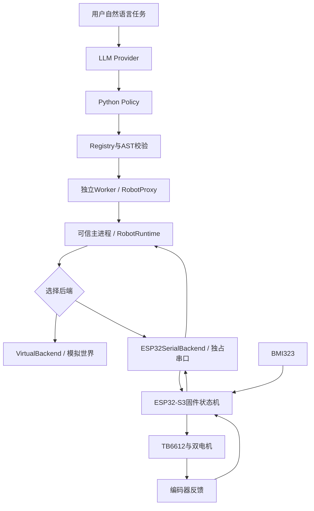

# 系统架构与各层职责

## 从任务到硬件

供电与电气连接另见[硬件接口讲解](HARDWARE_INTERFACES_GUIDE.md)。此图表达程序职责，不表示电机电流通过电脑或GPIO流动。

## 高层Python

| 模块 | 职责 |
| --- | --- |
| `main.py` | 统一选择virtual/esp32；默认模拟，实车显式执行 |
| `providers/` | 模型接口、离线mock和兼容服务请求 |
| `agent/` | 生成策略、会话上下文、任务规划和实车反馈决策 |
| `policy/` | 共享执行 Episode、实车/演示隔离的已验证策略库 |
| `runtime/validator.py` | 根据注册API与语法约束拒绝非法代码 |
| `runtime/worker.py`、`executor.py` | 在子进程运行受限代码，通过IPC请求动作 |
| `robot/capabilities.py` | 公开调用路径、参数、超时、返回字段与可信handler |
| `robot/runtime.py` | 动作分发、取消、command ID、trace与紧急停止 |
| `robot/backends/` | 虚拟、扰动、mock及真实串口后端 |
| `navigation/`、`task/`、`metrics/` | 观测导航、任务评分与实验指标 |

Worker只得到能力清单与RobotProxy，不持有串口或后端对象。Runtime和Backend在父进程；停止通路不等待普通动作锁。AST限制和子进程边界仍不等于可以执行任意恶意Python的操作系统级沙箱。

## 实车的三个执行层

电脑端处理任务与策略，不直接按时间猜测轮子已经到达目标；串口后端匹配START、目标STOP、RESULT、DONE和新的停稳READY；固件在本地持续处理编码器、IMU、PWM和时间/故障上限。

动作完成需要有效测量和停稳确认，串口写入STOP本身只能证明电脑尝试发送了字节。断线时停止可能无法送达，固件自己的动作上限仍独立存在。

## 分段任务

完整计划首先按硬件参数和9动作上限校验，再由主进程按最多3次调用+STOP切段，因此每段也最多3次运动。观测调用会占用分段位置。每段在新Worker中执行，保留同一个Runtime的command ID和累计trace。后端仅在健康停稳后更新本段预算，整项运动预算和180秒时限不更新。

WebUI默认用本地确定性检查审核段间反馈，可在设置切换模型审核。传给模型的是实际完成动作、编码器/陀螺仪测量、当前传感器、健康状态和剩余计划。模型只能输出`CONTINUE`或`ABORT: 原因`；下一段由主进程从原计划取出。代码、额外动作或错误格式会终止任务，故障与人工停止后不自动续跑。

这是有界计划的反馈审核。没有距离/位姿观测时，不把它描述成完整自主导航。

## 模拟和实车评分

模拟TaskEvaluator可读取独立世界状态或P4私有真值评分；这些信息不提供给Policy。实车没有同等地面真值，所以保留`execution_success`，把`task_success`记为null，编码器/陀螺仪字段带有估计量标记。

## 验证后策略复用

明确数字任务成功执行并获得有效停稳反馈后，可进入共享策略库。命中只省略代码生成，仍重新校验并在Worker执行，产生本次调用trace与实际反馈，不访问旧Runtime的结果缓存；command ID属于当前Runtime作用域。复用库与设备开机会话记忆分别保存，重启不会恢复位置或自动重播。模型请求/段间审核的用量与计时统一进入Episode。完整核对与边界见 [CAP接入说明](CAP_INTEGRATION_AUDIT.md)。
