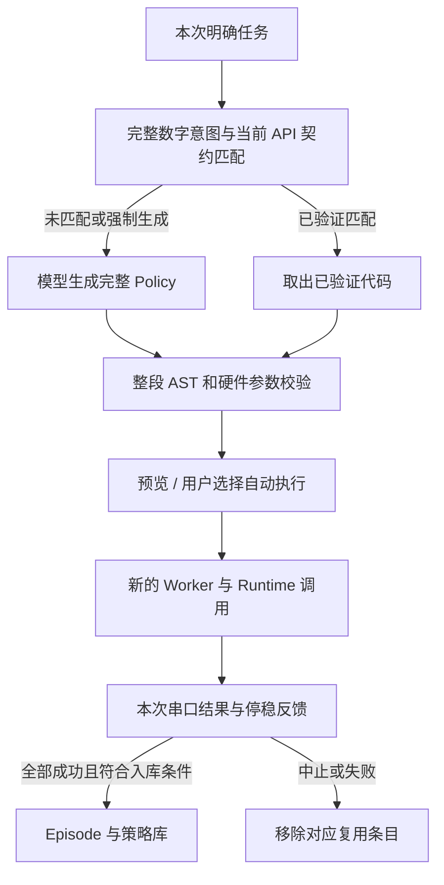

# CAP 高层能力接入核对：2026-10-12

本次核对覆盖原有模拟项目、优化报告、实车 CLI、WebUI 和 ESP32 串口边界。核心执行框架已经共享；原项目提到的 **Policy 复用此前只是后续计划**，本轮新增了实车已验证策略库。地图导航、视觉目标和独立地面评分仍需要真实观测，当前小车不发布这些接口。

原始依据是 [V0 需求](V0_REQUIREMENTS.md)、[模拟指南](SIMULATION_GUIDE.md)、[交互优化报告](../reports/interactive_optimization_2026-10-05.md)、[规划提示实验](../reports/planner_prompt_ablation_2026-10-07.md) 和下表中的源码。历史报告的任务、预算、成绩和实验协议保持原样。

## 能力逐项对应

| 高层能力 | 当前实车接入 | 代码与具体边界 |
| --- | --- | --- |
| Capability Registry、版本、参数和返回字段 | 已共享 | [capabilities.py](../robot/capabilities.py)、[串口 Registry](../robot/backends/esp32_serial.py)。按实际固件构建接口；v1.8 不注册 v1.9 后退、接近和传感器接口。首个动作前校验完整计划。 |
| 从 Registry 生成模型 API 提示 | 已共享 | [prompts.py](../agent/prompts.py)、[physical_policy.py](../agent/physical_policy.py)。提示与校验使用同一能力定义，不靠提示文字授权接口。 |
| AST、参数、预算校验 | 已共享并增加硬件边界 | [validator.py](../runtime/validator.py)、[physical_policy.py](../agent/physical_policy.py)。实车只允许直接调用、字面量参数和末尾 STOP；不开放模拟脚本的任意控制流程。 |
| 独立 Worker、RobotProxy、IPC | 已共享 | [executor.py](../runtime/executor.py)、[worker.py](../runtime/worker.py)。复用命中仍重新执行；Worker 不持有串口。 |
| 可信 Runtime、取消、动作 ID、trace | 已共享 | [runtime.py](../robot/runtime.py)。父进程调度、限额和取消不交给模型。命令结果幂等性只用于同一调用 ID，不是重复执行旧任务。 |
| 真实动作闭环与完成确认 | 已接入 | [串口后端](../robot/backends/esp32_serial.py)、[固件工程](../firmware/esp32s3/README.md)。匹配 START、目标停止、有效 RESULT、DONE 和新的停稳 READY。 |
| 状态、测距、姿态回传模型 | 已接入 | 生成和段间模型审核读取当前缓存，带有效性、时效或不可用原因；不补造地图、位姿或旧有效值。approach 另有固件实时测距闭环。 |
| 会话上下文与动作引用 | 已接入 | [physical_context.py](../agent/physical_context.py)、[controller.py](../webui/controller.py)。完成/失败/预览状态分开；“转回去”依据已完成任务的转向序列；设备重启清空会话引用。 |
| 分段任务与反馈审核 | 已接入 | [physical_mission.py](../agent/physical_mission.py)。整项最多 9 次运动、180 秒；每段最多 3 次调用再 STOP。WebUI 默认本地核对反馈，可选择模型 CONTINUE/ABORT。不增加动作或故障重试。 |
| 模型速度优化 | 已接入 | 稳定系统/API 前缀、默认关闭思考、WebUI 本地段间审核、停稳时避免重复 STOP；不在模型输出半个计划时运动。服务端前缀缓存由模型服务决定。 |
| Episode 与可比较指标 | 本轮统一 | [episode.py](../policy/episode.py)、[models.py](../metrics/models.py)。初末真实状态、API 签名、能力版本、代码、trace、计时、调用数与 Token；实车 `task_success=null`。 |
| 验证后 Policy 复用 | 本轮新增，CLI/WebUI 共用 | [reuse.py](../policy/reuse.py)。明确数字任务执行成功、反馈有效且停稳后入库；命中跳过生成，重新校验并执行。 |
| 低频 TaskPlanner + 确定性导航、GoalPlan、MissionRunner、P1–P4 | 保留模拟能力，未作为实车导航接入 | [task/](../task/)、[navigation/](../navigation/)、[模拟指南](SIMULATION_GUIDE.md)。依赖可定位地图和目标语义。单个前向测距与相对陀螺仪没有等价观测。 |
| TaskEvaluator、扰动真值与成功率 | 保留模拟评分 | [task/](../task/)、[reports/](../reports/README.md)。编码器和陀螺仪估计不能代替独立地面位置、绝对航向或碰撞真值。 |
| Skill、任意语义检索、自动生成辅助函数 | 尚未实现为实车能力 | V0 列为后续方向。本轮只复用明确任务的完整代码，不宣称任意任务都能迁移或自主修复。 |

本地段间检查沿用了高层项目“确定执行与核对留在可信侧、模型处理语义任务”的思路。手动持续遥控走已有 WebSocket/固件租约；自然语言任务继续经过 CaP 全链路。

## 新策略库怎样工作



第一次输入 `前进10厘米，然后左转30度，最后停止`，模型生成代码并通过校验；预览不会建立已验证条目。完成实际执行后，才可能入库。第二次同一任务，或可完整识别的等价写法，如 `向前走10cm；往左转30度；停车`，可命中代码。每次仍发送新的运动指令并取得新反馈，没有复用上次 RESULT，也不会自动重播历史。

复用条件同时要求：

1. 指令全部解析为明确前进、后退、左右转和末尾停止，顺序与代码完全一致，参数符合现有硬件范围。
2. 整次执行成功，无失败/取消 trace、无故障，最终连接、READY 和停稳有效；动作测量通过现有反馈核对。
3. Registry 的能力 ID、版本、路径、参数、返回字段和超时等契约一致，本次预算仍通过完整校验。
4. 来源 Episode、策略哈希和库格式有效；演示与实车分库存储。

“转回去”“再来一次”、条件任务、测距接近、观测调用、无法完整解析的写法继续请求模型，不因部分文本相似而套用旧动作。当前识别数字与限定句式；中文数字或其他同义句可交给模型。不会为超范围任务近似、截取或默默忽略一句话。

“已验证”表示代码与反馈流程通过，**不是独立地面精度验证**。轮胎打滑时编码器仍可能报告成功，不会因此生成 `task_success=true`。

## 使用与可见性

WebUI 默认启用“已验证策略复用”。设置可以关闭或清空策略库；任务区“本次强制模型生成”只绕过本次查库。预览和历史显示“模型生成”或“已验证策略复用”，并显示库条数和命中次数。默认预览/手动执行和主动勾选自动执行的行为不变。

CLI 与实车 WebUI 默认共用 `runs/policy-library/hardware.json`，DEMO 使用独立 `demo.json`。自定义 CLI `--log` 或控制器日志目录使用相邻独立库，方便隔离测试。库保存代码、契约和验证来源，不保存密钥或地面位置；本地 `runs/` 不上传 GitHub。

```bash
# 常规连续任务：查库，未命中请求模型
python main.py --backend esp32 --port COM5 --interactive --execute
# 完全绕过复用
python main.py --backend esp32 --port COM5 --interactive --execute --no-policy-reuse
# 指定独立库
python physical_control.py --port COM5 --interactive --execute --policy-library runs/policy-library/my-rover.json
```

CLI 沿用启动时隐藏输入 Key 的方式，即使本次命中也可能先询问一次 Key；命中后没有规划模型请求。WebUI 单段命中不需要创建 Provider；多段模型审核仍需要模型配置。

库可跨程序/设备重启保存，因为没有位置和会话引用。**模型记忆仍按开机 ID 清空**；新开机不会自动执行条目或以旧任务解释“转回去”。原子写入避免半份 JSON，当前没有跨进程事务锁，同时写入可能丢失新增条目，后续退回模型生成。多个进程不应同时控制同一串口。

## 记录和性能解释

实车与模拟 Episode 共享结构。WebUI 完整记录位于 `runs/webui/episodes/<episode_id>.json`；CLI 每任务 `episode` 位于已有日志，包含：

- `api_surface_signature`、`used_capabilities`、初末真实状态、代码与 trace。
- `execution_success`、错误类别、`task_success=null`。
- `planning_llm_calls`、`review_llm_calls`、合计 `llm_calls`；生成与模型段间审核合计 Token。缺少用量或请求失败时记 `null`，不当作 0。
- 模型请求、校验、执行、串口反馈、任务总耗时，以及新增 `policy_lookup`；模型审核时长保留在 `reviews`。`llm_ttft_ms` 是规划请求首次输出时间，不跨请求相加。
- `policy_source`、`model_call_skipped`、`reused_from`，区分代码库命中与模型请求。

预览和随后点击执行分别记录Episode。执行记录保留生成阶段的耗时、用量和来源供展示，但用`planning_request_inherited=true`及`generation_job_id`标明继承；其模型调用与Token计数只算本阶段新请求，避免两份记录重复收费统计。自动生成并执行则在同一Episode统计。

命中的规划模型耗时为 0，仍保留执行、测量和停稳等待；开启模型段间审核时，该审核仍计入模型调用与耗时。首次任务、上下文引用和动态测距任务的模型延迟取决于服务，没有固定倍数承诺。

离线 DEMO、假串口与真实 Worker 验证了首次学习、再次执行而不请求模型、预览不学习、接口变化/损坏/超预算拒绝复用、错误反馈/取消/失败不能入库，以及强制生成、关闭、清空和 CLI 共享路径。测试不连接实车或付费 API，未自动执行小车动作。

测距偏移 −20mm、姿态安装 ±90° 选项、静止航向归零继续保留。前方停车保护仍 OFF；已取消的外部 5V 检测不加入此次接入。
